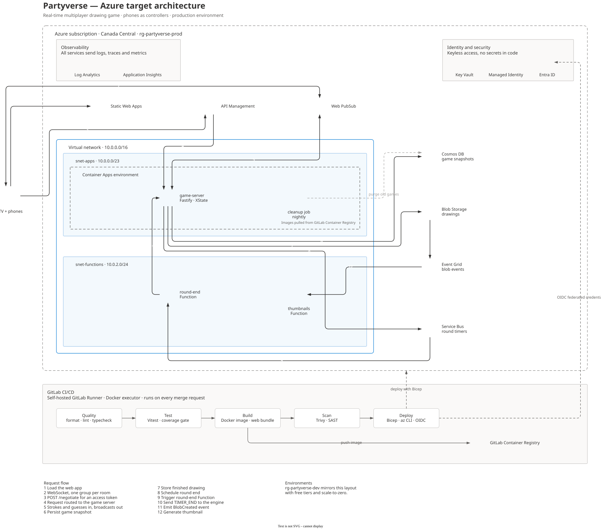

# Partyverse — A real-time multiplayer party game where your phone is the controller.

[](https://gitlab.com/SamyBaouche/partyverse/-/pipelines)
[](https://gitlab.com/SamyBaouche/partyverse/-/pipelines)
[](LICENSE)

A TV (or laptop) shows the game; players scan a QR code and draw, guess and compete from their phones. No app install, no account.

> Development, CI/CD and issue tracking happen on **GitLab**: [gitlab.com/SamyBaouche/partyverse](https://gitlab.com/SamyBaouche/partyverse).
> The GitHub repository is a **read-only mirror**.

---

## Status

|                     |                                                                          |
| ------------------- | ------------------------------------------------------------------------ |
| **Current release** | `v0.1` — Sprint 1: foundations, game engine, arcade UI and first screens |
| **Next milestone**  | Sprint 2 — complete front-end and real-time wiring with Azure Web PubSub |
| **Target**          | `v1.0` deployed on Azure by January 2027                                 |

## Features

### Available today (local, mock mode)

- **Drawing game engine**: XState state machine (`lobby → drawing → reveal → scores`), turn rotation, accent- and case-insensitive guessing, scoring (`apps/server/src/game/machine.ts`).
- **Game rooms**: 4-letter room codes (alphabet without `I`/`O`), join / leave / host-only kick, 8 players max, duplicate nickname protection (`apps/server/src/game/rooms.ts`).
- **Shared message contract**: client and server messages validated with Zod in `@partyverse/shared` (never trust the client).
- **Arcade UI**: dark sandbox theme with selectable arcade backgrounds, Press Start 2P + Inter fonts, synthesized 8-bit SFX and chiptune music (Web Audio API, no audio files), confetti and countdown.
- **TV lobby**: room code, QR code (`qrcode.react`), live mock player list, press-start gate.
- **Phone join flow**: Zod-validated nickname, waiting screen, friendly `RoomErrorCode` messages (mock join).
- **Drawing canvas**: clean SVG strokes with a color palette, normalized coordinates, 50 ms live chunking, Clear button, `/draw-demo` TV mirror.
- **HTTP health endpoint** on the Fastify server (`GET /health`).

### Planned

- Real-time play across devices with **Azure Web PubSub**.
- Cloud deployment on **Azure** (Static Web Apps, Container Apps, Cosmos DB, Service Bus, Functions, Blob Storage, Key Vault, App Insights).
- Wiring the game engine and rooms to live network transport (today they run locally / under tests).
- Stateless, crash-resilient engine with persisted snapshots.
- Load testing, observability, and GitLab CI/CD deploy to Azure with OIDC.

## Architecture (target)

> Target architecture for `v1.0` — not deployed yet.



Architecture decisions are documented as ADRs in [`docs/adr`](docs/adr).

## Tech stack

| Layer           | Technologies                                                                                                                                     |
| --------------- | ------------------------------------------------------------------------------------------------------------------------------------------------ |
| Front-end       | React 19, TypeScript, Vite 8, Tailwind CSS v4, React Router, Motion, qrcode.react, canvas-confetti, Web Audio API                                |
| Back-end        | Node.js 24, Fastify 5, XState 5                                                                                                                  |
| Shared          | `@partyverse/shared` — Zod 4 schemas and inferred TypeScript types                                                                               |
| Testing         | Vitest, `@vitest/coverage-v8`                                                                                                                    |
| Tooling         | pnpm workspaces (`pnpm@12.18.0`), ESLint, Prettier, TypeScript strict mode                                                                       |
| CI/CD           | GitLab CI (`.gitlab-ci.yml`), self-hosted GitLab Runner with Docker executor (`node:24-alpine`)                                                  |
| Cloud (planned) | Azure Container Apps, Static Web Apps, Web PubSub, Cosmos DB, Service Bus, Functions, Blob Storage, Key Vault, App Insights, Bicep, OIDC deploys |

## Repository structure

```
partyverse/
├── apps/
│   ├── web/          # React front-end (TV + phone screens)
│   ├── server/       # Fastify game server (rooms, XState engine, /health)
│   └── functions/    # Azure Functions package stub (planned)
├── packages/
│   └── shared/       # Zod schemas and shared types
├── docs/
│   ├── metrics.md              # Measured metrics and how they were measured
│   ├── architecture/           # Target Azure architecture diagrams
│   └── adr/                    # Architecture Decision Records
├── .gitlab-ci.yml
├── .node-version     # 24
└── pnpm-workspace.yaml
```

## Getting started

### Prerequisites

- **Node.js 24** (see `.node-version`; `engines.node` is `>=24`)
- **pnpm** pinned via `packageManager`: `pnpm@12.18.0` (Corepack: `corepack enable`)

### Install and run

```bash
pnpm install

# Front-end — http://localhost:5173
pnpm --filter @partyverse/web dev

# Game server — http://localhost:3000/health
pnpm --filter @partyverse/server dev
```

To try the UI on a phone, open the **Network** URL printed by Vite (same Wi-Fi as your computer), for example `http://<your-lan-ip>:5173/play/ABCD`. Do not use `localhost` in the QR / phone URL.

## Development pages

Routes from `apps/web/src/main.tsx`:

| Route          | Purpose                                                  | Availability |
| -------------- | -------------------------------------------------------- | ------------ |
| `/`            | Redirects to `/host`                                     | Always       |
| `/host`        | TV lobby (press start, room code, QR, mock players)      | Always       |
| `/play/:code`  | Phone join flow                                          | Always       |
| `/backgrounds` | Arcade background picker                                 | Always       |
| `/ui`          | Design-system and effects gallery                        | **Dev only** |
| `/draw-demo`   | Drawing canvas + live “TV mirror” and Zod chunk counters | **Dev only** |

## Scripts

| Command                                          | Description                                  |
| ------------------------------------------------ | -------------------------------------------- |
| `pnpm dev`                                       | Run all package `dev` scripts in parallel    |
| `pnpm build`                                     | Build every package that defines `build`     |
| `pnpm lint`                                      | ESLint on the whole monorepo                 |
| `pnpm format` / `pnpm format:check`              | Format with Prettier / check formatting      |
| `pnpm typecheck`                                 | TypeScript `--noEmit` in every package       |
| `pnpm test`                                      | Run all package tests                        |
| `pnpm --filter @partyverse/web dev`              | Vite dev server for the web app              |
| `pnpm --filter @partyverse/web build`            | Typecheck + production build for the web app |
| `pnpm --filter @partyverse/server dev`           | Fastify server with `tsx watch`              |
| `pnpm --filter @partyverse/server test`          | Server Vitest suite                          |
| `pnpm --filter @partyverse/server test:coverage` | Server tests with v8 coverage report         |

## Quality and CI

Every merge request runs a GitLab pipeline on a **self-hosted GitLab Runner** (Docker executor, image `node:24-alpine`):

| Stage     | Jobs                                                                           |
| --------- | ------------------------------------------------------------------------------ |
| `quality` | `format`, `lint`, `typecheck` (parallel)                                       |
| `test`    | `pnpm --filter @partyverse/server test:coverage` (Cobertura in merge requests) |
| `build`   | `build-web`, `build-server`                                                    |

`main` is protected: changes land only through merge requests with a **green pipeline**.

## Metrics

All metrics are measured, dated and reproducible — see [`docs/metrics.md`](docs/metrics.md).

| Metric                            | Value | As of      |
| --------------------------------- | ----- | ---------- |
| Game engine test coverage (lines) | 98%   | 2026-11-10 |

## Roadmap

| Sprint | Dates        | Focus                                                            | Status        |
| ------ | ------------ | ---------------------------------------------------------------- | ------------- |
| 0      | Nov 7–8      | Accounts, tooling, GitLab, self-hosted runner                    | Done          |
| 1      | Nov 9–15     | Monorepo, game engine, tests, CI, arcade UI, first screens       | Done (`v0.1`) |
| 2      | Nov 16–22    | Complete front-end, real-time with Web PubSub, architecture docs | In progress   |
| 3      | Nov 23–29    | Docker, Bicep, first Azure deployment                            | Planned       |
| 4      | Nov 30–Dec 6 | Full CI/CD with OIDC, dev and prod environments                  | Planned       |
| 5      | Dec 7–13     | Stateless engine, Service Bus timers, resilience                 | Planned       |
| 6      | Dec 14–20    | Blue-green releases, observability, E2E tests                    | Planned       |
| 7      | Dec 21–27    | Load testing and performance                                     | Planned       |
| 8      | Dec 28–Jan 1 | Documentation, demo and `v1.0`                                   | Planned       |

## Contributing workflow

1. Pick an issue on the GitLab board and move it to **Doing**.
2. Create a branch from an up-to-date `main` (`feat/<issue>-<short-name>`).
3. Use [Conventional Commits](https://www.conventionalcommits.org/) (`feat:`, `fix:`, `test:`, `ci:`, `docs:`).
4. Open a merge request with `Closes #<issue>` and merge once the pipeline is green.

## Credits

Fonts and audio credits are listed in [`apps/web/CREDITS.md`](apps/web/CREDITS.md). All sounds and music are generated in code with the Web Audio API (no external audio files).

## License

[MIT](LICENSE) © Samy Baouche
